  <a href="https://shravankumar-janawade.vercel.app">
    <picture>
      <source media="(prefers-color-scheme: dark)" srcset="https://readme-typing-svg.demolab.com?font=JetBrains+Mono&weight=500&size=20&duration=3500&pause=1200&color=A78BFA&center=true&vCenter=true&width=620&height=32&lines=SDE+Intern+%40+AWS+Bedrock+AgentCore+%28Summer+2026%29;MS+CS+%40+Northeastern+%C2%B7+4.0+GPA;TA+for+CS5610+Web+Development+%28Spring+2026%29;1st+Place+%C2%B7+Brain+Storm+BCI+Hackathon+%282026%29;Building+databases+in+Rust+and+tools+for+CI%2FCD" />
      <source media="(prefers-color-scheme: light)" srcset="https://readme-typing-svg.demolab.com?font=JetBrains+Mono&weight=500&size=20&duration=3500&pause=1200&color=6D28D9&center=true&vCenter=true&width=620&height=32&lines=SDE+Intern+%40+AWS+Bedrock+AgentCore+%28Summer+2026%29;MS+CS+%40+Northeastern+%C2%B7+4.0+GPA;TA+for+CS5610+Web+Development+%28Spring+2026%29;1st+Place+%C2%B7+Brain+Storm+BCI+Hackathon+%282026%29;Building+databases+in+Rust+and+tools+for+CI%2FCD" />
      
    </picture>
  </a>

  
  
  
  
  

## About me

I'm a software engineer and MS CS student at Northeastern University (4.0 GPA, graduating May 2027). I build databases, developer tools, and full-stack apps.

☁️ **SDE Intern, Amazon Bedrock AgentCore** (Summer 2026): built a service that detects attacks in AI agent logs and writes Cedar access policies to block them. The AgentCore team adopted the design for an upcoming feature. 
🧑‍🏫 **Graduate TA, CS5610 Web Development** (Spring 2026): mentored 60+ graduate students. 
🏆 **1st Place, Neural Decoder track**, Brain Storm BCI Hackathon by Precision Neuroscience (2026). 
🔭 Open to new grad software engineering roles.

## Featured projects

**[FluxDB](https://github.com/ShravanJanwade/FluxDB)** &nbsp;·&nbsp; [Live demo](https://fluxdb.icygrass-95174406.westus2.azurecontainerapps.io) 
A multi-tenant time-series database in Rust. LSM-tree storage with a checksummed write-ahead log, so every write is on disk before it's confirmed, plus SQL with time buckets. 
Access control with 4 roles, revocable API keys, and GitHub OAuth; tests confirm tenants can't read each other's data. 

**[CodeLens](https://github.com/ShravanJanwade/CodeLens)** &nbsp;·&nbsp; [Live demo](https://codelens.icygrass-95174406.westus2.azurecontainerapps.io) 
Explains why a CI build failed and whether a specific commit caused it. 95.8% accurate on a 240-case benchmark. 

**[Neural Decode](https://github.com/ShravanJanwade/Neural-Decode-BCI)** 
A real-time neural signal decoder that won 1st place in the Neural Decoder track at the Brain Storm BCI Hackathon by Precision Neuroscience (2026). 

**[WorkNest](https://github.com/ShravanJanwade/WorkNest)** &nbsp;·&nbsp; [Live demo](https://work-nest-rust.vercel.app) 
A real-time project management app with Kanban boards synced over WebSockets. 

## Experience

| Role | Company | Dates | Highlights |
| :-- | :-- | :-- | :-- |
| **Software Development Engineer Intern** | Amazon Web Services, Bedrock AgentCore (Seattle) | Jun&nbsp;2026 – Aug&nbsp;2026 | Wrote Rust detectors for prompt injection and data exfiltration, plus a 25,000+ attack benchmark. Adding a Bedrock model as a second check raised recall from 94% to 97% and precision from 90% to 95%. |
| **Graduate Teaching Assistant, CS5610 Web Development** | Northeastern University, Khoury College (Boston) | Jan&nbsp;2026 – Apr&nbsp;2026 | Held office hours and led project and demo reviews for 60+ graduate students building full-stack apps in React, Node.js, and MongoDB. |
| **Associate Software Engineer** (converted from intern, Apr 2024) | Torry Harris Integration Solutions (Bengaluru) | Sep&nbsp;2023 – Jul&nbsp;2025 | Rebuilt notification delivery for 5,000+ clients on Kafka, Redis, and WebSockets (failures from 8% to under 1%). Built secure sign-in for 10,000+ daily logins (70% less login database load). Cut vendor onboarding from 2 weeks to under 3 hours. |

## Tech stack

<table>
  <tr>
    <td><b>Languages</b></td>
    <td></td>
  </tr>
  <tr>
    <td><b>Frameworks and runtimes</b></td>
    <td></td>
  </tr>
  <tr>
    <td><b>Data and messaging</b></td>
    <td></td>
  </tr>
  <tr>
    <td><b>Cloud and tooling</b></td>
    <td></td>
  </tr>
</table>

## Achievements

🏆 1st Place, Neural Decoder track, Brain Storm BCI Hackathon by Precision Neuroscience (2026) 
🏆 1st Place, Karnataka State Hackathon (undergraduate) 
📄 Co-author, ["RC Delivery Robot Using GPS System"](https://papers.ssrn.com/sol3/papers.cfm?abstract_id=4971670) (2024), SSRN

## GitHub activity

  
  

  

  

  <a href="https://github.com/ShravanJanwade">
    <picture>
      <source media="(prefers-color-scheme: dark)" srcset="https://raw.githubusercontent.com/ShravanJanwade/ShravanJanwade/output/github-snake-dark.svg" />
      <source media="(prefers-color-scheme: light)" srcset="https://raw.githubusercontent.com/ShravanJanwade/ShravanJanwade/output/github-snake.svg" />
      
    </picture>
  </a>

